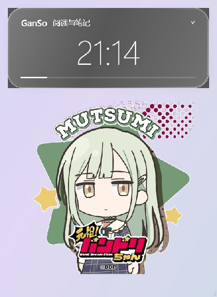
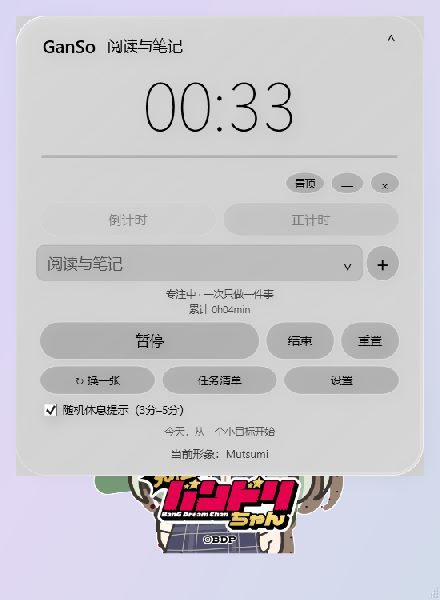
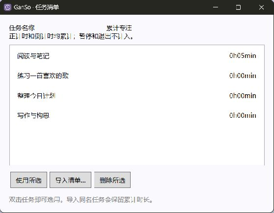

# GanSo · 专注伙伴

可独立运行的 Windows 桌面专注计时器：角色陪伴、玻璃面板、数字正计时与倒计时，以及随机休息提示。无需启动 Codex，无需联网。

**图片版权归 BushiRoad BanGDream Project 所有，请勿商用。** 本项目仅供个人学习与非商业使用，详见 [版权声明](COPYRIGHT.md) 和 [使用条款](LICENSE)。

## 实际运行

常显时陪你专注，点击时间卡片即可向下展开控制。两种计时模式，都把投入记在对应任务里。

| 常显倒计时 · 深色白字 | 展开正计时 · 浅色黑字 |
| :---: | :---: |
|  |  |

**每一分投入，都留在任务里。** 自拟任务、导入清单，正计时和倒计时共用累计专注记录。

<p align="center"></p>

以上为 Windows 上的实际运行截图，使用演示任务；面板会随深浅模式和桌面背景呈现不同效果。

## 下载与运行

1. 在 [Releases](https://github.com/Create4220/GanSo/releases/latest) 下载 `GanSo-v1.2.2-windows-x64.zip`。
2. 完整解压到可写文件夹，双击 `GanSo.exe`。请保留旁边的 `assets` 文件夹。

适用于 Windows 10 / 11，需要 .NET Framework 4.8。支持的 Windows 11 版本使用系统 Desktop Acrylic 玻璃背景；其他环境使用磨砂面板。运行便携包不需要 Python 或 Node.js。

## 功能

- **倒计时 / 正计时**：数字显示，支持暂停、继续、重置和完成提示。正计时超过一小时显示 `HH:MM:SS`。
- **任务清单**：自拟名称、保存与选择任务，支持 UTF-8 TXT / JSON 导入。
- **累计专注**：每个任务显示 `XhXXmin`，按实际运行秒数累计；暂停与退出不计入。
- **角色陪伴**：60 张透明角色图，启动随机，手动换图；保留名字字母、星星与白色爆炸框。
- **玻璃面板**：上方时间块、下方人物，单列紧凑布局。浅色黑字、深色白字，可跟随系统。支持拖动、置顶、最小化和托盘恢复。
- **独立运行**：关闭 Codex 后仍可使用，最小化继续计时，退出后暂停，下次可继续。

v1.2.2 修复了 15 张形象的服装及小熊白色区域被误透明的问题，仅恢复透明度，保留原图颜色；已逐张复核确认。

### 常显与展开

人物、任务名称、数字时间和进度条始终显示。时间块位于人物头顶，正式的 **GanSo** 标题显示在任务名称之前。默认窗口宽度为 440 像素。

单击常显区，其他控件从时间块下方向下展开，重叠区域遮挡人物，不把人物挤走。再次单击收起，恢复完整人物；时间块位置始终不变。

展开界面的底部显示当前形象名字，换图后同步更新。主唱十人按提供的名单对应，全员类按原图字母核对；统一使用首字母大写，其余字母小写，保留名字中的长音符号和 `Chu²` 的上标。

按住人物或常显区都可以拖动整个伙伴。超过拖动阈值后按拖动处理，不会误展开。点击人物只显示短暂的按压变暗效果，不打开控制区；松开、失去鼠标捕获或窗口失去激活后恢复原样，不修改原图颜色。

完成提示固定为完整播放三次 Codex 提示音，与随机提示复选框无关；“完成时播放提示音”仍可静音，Escape 可停止播放。

## 随机休息提示

勾选“随机休息提示”，即可在两种计时模式中启用：

- 默认每累计 **3–5 分钟**实际运行时间，随机播放一次所选提示音；间隔可调整。
- 显示约 **10 秒**的闭眼放松提示，计时继续，不自动暂停。
- 暂停期间不响，恢复后接着等待。
- 无论是否开启随机提示，倒计时归零或正计时点击“结束”，都固定连续完整播放 **三次 Codex 提示音**。
- 复选框只控制过程中的随机休息提醒，完成声音可单独静音。

### 思路与灵感来源

随机休息提示的思路与灵感来自 **B 站 UP 主择恩**：

**[《为什么我能每天学习10小时》——原 B 站视频](https://www.bilibili.com/video/BV1naLozQEBq/)**

视频建议在专注中随机插入短休息，并以约 90 分钟专注 / 20 分钟休息为示例周期。GanSo 不强制该周期，也不承诺视频提及的效率提升幅度。详见 [随机提示说明](docs/random-cues-video.md)。

## 任务写入接口

GanSo 不读取 Codex 聊天标题、正文或历史记录，仅接收显式调用写入的任务。在程序文件夹打开 PowerShell：

```powershell
.\Send-GanSoTask.ps1 -Task '整理阅读笔记' -Minutes 25
.\Send-GanSoTask.ps1 -Task '整理阅读笔记' -Minutes 25 -Start
.\Send-GanSoTask.ps1 -ImportFile '.\tasks.example.json'
```

正在计时时，切换指令先排队，批量清单仍可导入。同名任务更新预设时长并保留累计记录。

```json
{"tasks":[{"name":"整理阅读笔记","minutes":25},{"name":"短休息","minutes":5}]}
```

任务、设置与累计时间只保存在本机 `data` 文件夹。公开仓库和下载包不包含开发者个人数据；升级时请保留自己的 `data`。

## 从源码构建

在 Windows 上克隆仓库，正常退出本目录中运行的 GanSo，然后执行：

```powershell
.\build.ps1
.\GanSo.Tests.exe
.\package.ps1 -Version '1.2.2'
```

程序使用 WPF / C# 与 .NET Framework 4.8，无运行时第三方包，构建不需要 Python。仓库包含运行所需的透明图片与音频。

`tools/cutouts.py` 是可选图片处理工具，需要 `tools/requirements.txt` 中的依赖。JPEG 原图不随仓库分发；如需重新处理，将自己持有的原图放入 `assets/images`，原文件不会被覆盖。

`tools/cutout-protection.json` 保存人工核对过的白色服装与小熊区域，重新抠图时自动保护这些区域。`tools/restore_cutout_colors.py` 可预览透明度修补，添加 `--apply` 才替换透明 PNG；原图颜色与其他形象保持不变。

`package.ps1` 按明确清单生成便携包，不包含 `data`、日志、测试结果或开发缓存。

## 致谢与版权

- **图片、角色及相关标识：BushiRoad BanGDream Project。请勿商用。**
- 随机休息提示灵感：[择恩的原 B 站视频](https://www.bilibili.com/video/BV1naLozQEBq/)。
- 玻璃视觉参考：[Glass-HQ/liquid-glass](https://github.com/Glass-HQ/liquid-glass)。保留原生 Windows 实现，没有使用其 WebGPU 渲染代码。
- Codex 提示音来源于 OpenAI Codex 桌面应用，相关素材权利归原权利方。

本项目不是相关权利方的官方产品；程序代码的条款不改变第三方素材的版权归属。
